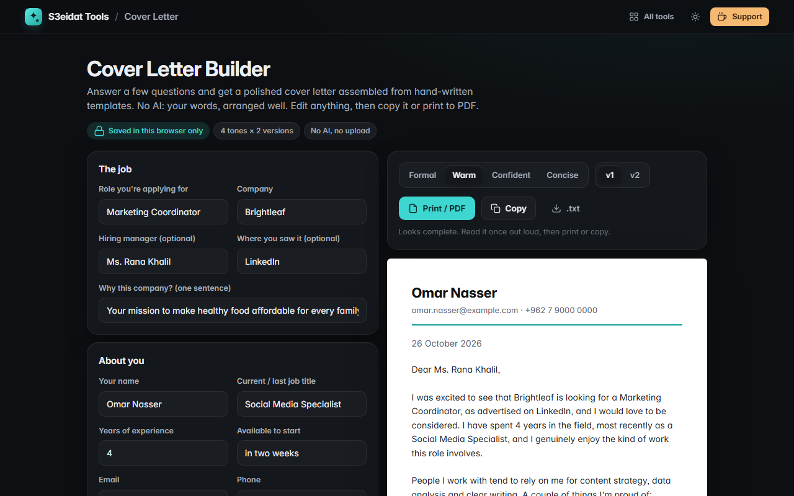

# Cover Letter Builder

> Fill in the blanks, pick a tone, get a polished cover letter. No AI: hand-written templates and your own words. Free, private, and it runs entirely in your browser.

### ▶ [Open Cover Letter Builder](https://s3eidat.github.io/cv-letter/)



## Features

- A short guided form: role, company, hiring manager, why this company, your current role, years of experience, three strengths, two achievements
- **4 tones** (Formal, Warm, Confident, Concise), each with **2 hand-written versions**
- Small grammar details handled for you: "a"/"an", lists ("A, B and C"), "Yours sincerely" vs "Yours faithfully"
- Missing details show as `[placeholders]`, and the tool tells you what's still to fill in
- The letter is **fully editable**; your edits are kept until you choose to rebuild (with undo)
- **Print / save as PDF** (A4, letter only), **copy**, or download **.txt**
- **Autosaves** in this browser

## Privacy

Nothing leaves your device. There is no AI service and no server: the letter is assembled by plain JavaScript
templates in your browser and saved in localStorage. The page ships with a strict Content-Security-Policy
(`connect-src 'self'`), so the browser itself blocks any attempt to send data anywhere.

## Run it yourself

It's plain HTML, CSS and JavaScript with no build step:

```bash
git clone https://github.com/s3eidat/cv-letter
cd cv-letter
python -m http.server 8000
```

Then open http://localhost:8000.

## Support

If this saved you time, **[buy me a coffee ☕](https://s3eidat.github.io/coffee/)**. It keeps every tool free.

---

Part of **[S3eidat Tools](https://s3eidat.github.io/)**: 100+ free, private tools that run in your browser. MIT licensed.
